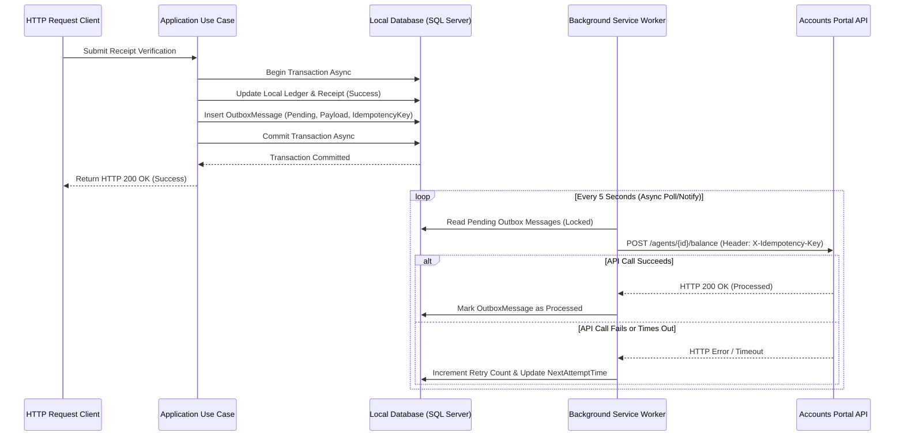

# Integration Consistency Strategy

This document details the consistency, retry, and outbox designs for communication between the Texas Sales Portal and the external Accounts Portal.

---

## 1. Inventory of External API Calls

| Operation | Laravel Service Method | I/O Type | Criticality | Target Consistency Model | Retry Safe? |
| :--- | :--- | :--- | :--- | :--- | :--- |
| **Get Suppliers** | `getSuppliers` | GET | Low | Read-only cache / sync | Yes |
| **Get Agents** | `getAgents` | GET | Low | Read-only cache / sync | Yes |
| **Get Banks** | `getBanks` | GET | Low | Read-only cache / sync | Yes |
| **Update Agent Balance** | `updateAgentBalance` | POST | **Critical** | Eventual (via Outbox) | Yes (Only with Idempotency Key) |
| **Update Agent Wallet** | `updateAgentWallet` | POST | **Critical** | Eventual (via Outbox) | Yes (Only with Idempotency Key) |
| **Store Deposit** | `storeDeposit` | POST | **Critical** | Eventual (via Outbox) | Yes (Only with Idempotency Key) |
| **Get Staff Payroll** | `getStaffPayroll` | GET | Medium | Synchronous Read | Yes |

---

## 2. Transactional Outbox Pattern Design

To guarantee reliability, we replace the in-memory Channels with a **Transactional Outbox**. Outbox messages are stored in the local database within the *same database transaction* as the financial updates.

### Conceptual Flow Diagram

---

## 3. Consistency and Error Scenarios

### Local Success + Remote Failure
- **Behavior**: Local receipt allocation is completed, and the database transaction commits successfully. The outbox message is saved. If the remote HTTP request fails, the Background Worker retries execution exponentially.
- **Result**: Immediate consistency is maintained locally. Remote consistency is achieved eventually.

### Remote Success + Lost HTTP Response
- **Problem**: The Accounts Portal processes the balance update, but the network drops before returning the response. The background worker treats it as a failure and retries.
- **Solution**: The request must pass a unique `X-Idempotency-Key` (e.g. `receipt_id`). The Accounts Portal must store this key and return the previous success response instead of executing duplicate balance updates.

---

## 4. Accounts Portal Modification Requirement

> [!WARNING]
> The current Accounts Portal endpoints (`POST /agents/{id}/balance`, `POST /banks/{id}/deposit`) do not accept idempotency keys or unique references in their payloads. Retrying a failed request will lead to duplicate balance adjustments.
>
> **Mandatory Modification**:
> 1. The Accounts Portal must be updated to support an `X-Idempotency-Key` header (or accept `receipt_id`/`deposit_id` inside the JSON payload).
> 2. The Accounts Portal must verify this key against a list of processed transactions before executing credit/debit mutations. If the key exists, it must return `HTTP 200 OK` (with cached response data) without modifying the account state.

---

## 5. Reconciliation Process

An automated background query runs daily to reconcile the two systems:
- Fetch local ledger credit balances for all agents.
- Fetch remote agent balances from the Accounts Portal.
- Flag any agent whose local balance mismatch exceeds `0.001` variance.
