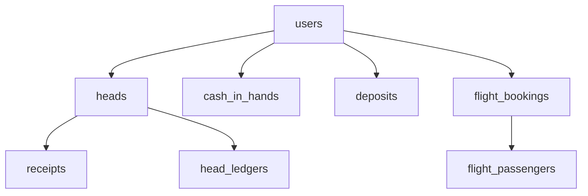

# MySQL to SQL Server Data Migration Strategy

This document details the strategy for extracting data from the legacy MySQL database, transforming it, and loading it into the target SQL Server database.

---

## 1. Tooling Recommendation
We recommend building a custom **C# Migration Utility Console App** (or using **Azure Data Factory / SqlServer Integration Services (SSIS)**).
A C# utility:
- Can run locally or as a task in the CI/CD pipeline.
- Uses `Microsoft.Data.SqlClient` and standard ADO.NET `SqlBulkCopy` for high-throughput streaming bulk inserts.
- Utilizes our concrete Domain entities and EF configurations to ensure type compatibility.

---

## 2. Dependency Load Order

To avoid foreign key constraint violations during loading, tables must be loaded in the following order:



1. **`users`** (Primary identity tables, zero foreign dependencies).
2. **`heads`** (Depends on `users`).
3. **`cash_in_hands`**, **`deposits`**, **`staff_monthly_records`** (Depends on `users`).
4. **`leads`**, **`disputes`** (Depends on `users`).
5. **Bookings** (`flight_bookings`, `hotel_bookings`, `sales_visa_applications`, `vfs_appointments`, `holiday_packages`, `transportations`, `other_services`) (Depends on `users` and `heads`).
6. **Booking Details & Fees** (`flight_passengers`, `sales_visa_applicants`, `sales_visa_govt_fees`, `vfs_appointment_govt_fees`, `holiday_package_govt_fees`, `holiday_package_documents`) (Depends on parent bookings).
7. **`receipts`** (Depends on `users` and `heads`).
8. **`head_ledgers`** (Depends on `heads`).

---

## 3. Data Transformations and Identity Preservation

1. **Identity Preservation**:
   - Legacies use `AUTO_INCREMENT` values. To preserve PK ids, we must enable identity insertion before bulk loading:
     ```sql
     SET IDENTITY_INSERT target_table ON;
     -- Run bulk insert
     SET IDENTITY_INSERT target_table OFF;
     ```
2. **Booleans**:
   - MySQL `tinyint(1)` (e.g. `is_active`, `is_inhouse`, `is_edited`) mapped to SQL Server `bit` (values `0` or `1`).
3. **Strings and Enums**:
   - Truncate whitespace, map legacy empty strings to `NULL` where columns are nullable, and validate enum strings against constraints before loading.
4. **Date/Time Conversion**:
   - Parse MySQL timezone timestamps, normalizing them to `DateTime` with `DateTimeKind.Unspecified` representing local `Asia/Bahrain` time.
