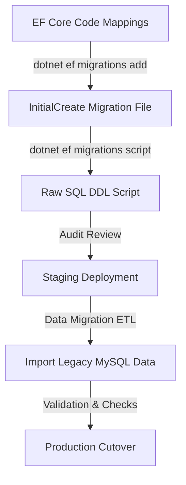

# SQL Server Schema Deployment Strategy

This document details the strategy for deploying the database schema to the modernized Microsoft SQL Server target database.

---

## 1. Schema Lifecycle and Deployment Steps

Since the destination SQL Server database starts as completely empty, we do not need a legacy baseline mock strategy. Instead, we use an incremental migration approach.



### Step 1: Migration Generation
- Generate the initial schema migration using EF Core CLI:
  ```bash
  dotnet ef migrations add InitialCreate --project src/TexasPortal.Infrastructure --startup-project src/TexasPortal.Api
  ```

### Step 2: SQL Script Audit
- Generate the raw SQL schema generation script:
  ```bash
  dotnet ef migrations script --project src/TexasPortal.Infrastructure --startup-project src/TexasPortal.Api -o schema_deploy.sql
  ```
- A database administrator or senior developer must manually audit `schema_deploy.sql` to verify indexes, column sizes, constraint check values, and nullable settings.

### Step 3: Deployment to Staging
- Apply the migration script to the empty staging SQL Server instance.

### Step 4: Data Import (ETL)
- Execute the ETL tool to import legacy MySQL records into the newly created SQL Server staging database.

### Step 5: Post-Deployment Verification
- Run the Financial Reconciliation queries (comparing debit/credit ledger sums, head balances) to verify target data integrity before go-live.

---

## 2. Backup & Rollback Policy

- A full database backup must be taken prior to any schema deployment.
- Rollback: If a schema deployment fails or corrupts data, restore the database from the backup snapshot immediately.
