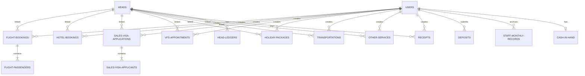

# Sales Portal Analysis

This document provides a comprehensive analysis of the Laravel Sales Portal, including routes, models, views, controllers, migrations, and database relationships.

## Route Architecture

The Laravel application exposes two main route sets:
1. **Web Routes (`routes/web.php`)**: HTML/Blade-based interface for salesmen to manage heads, bookings, receipts, and view their dashboard.
2. **API Routes (`routes/api.php`)**: Protected by API-key authorization headers (`X-OPS-KEY` for Operations Portal integration, `X-SYNC-KEY` for Staff Sync) or Sanctum tokens for mobile/API clients.

## Models and Entities

The system contains the following key Eloquent models:

- **User**: Represents staff (Salesmen, Admins) tracking their login logs, monthly sales targets, profit generated, incentives, and basic salary configs.
- **Head**: Represents customers or external agents. Tracks balance, ledger transactions, and wallet deposits.
- **HeadLedger**: Standardized transaction ledger tracking debits (booking charges) and credits (verified receipts or wallet deductions) for each Head.
- **CashInHand**: Tracks the cash amount currently held physically by each salesman.
- **Deposit**: Tracks bank/account cash deposits made by salesmen to clear their cash-in-hand balance.
- **Receipt**: Tracks customer/agent payments. Validated receipts trigger booking fund allocations, ledger entries, and agent sync.
- **Lead**: Tracks sales opportunities, reminders, and service interest.
- **Dispute**: Tracks disputes or chargebacks raised on specific bookings or receipts.
- **StaffMonthlyRecord**: Archives monthly performance stats (profit, targets achieved) for staff.
- **Bookings (7 Categories)**:
  1. **FlightBooking**: Details flight route, and has many `FlightPassenger` records (which track individual ticket cost/profit).
  2. **HotelBooking**: Details hotel room nights, check-in, guest names, and costs.
  3. **SalesVisaApplication**: Header for visa application, country, and contains many `SalesVisaApplicant` records.
  4. **VfsAppointment**: Details visa processing appointments, country, and scheduling.
  5. **HolidayPackage**: Tracks custom holidays packages and associated document uploads.
  6. **Transportation**: Tracks drop locations, pickup times, and driver/vehicle costs.
  7. **OtherService**: Custom generic service with narrations.

---

## Database Relationships

### Relationship Design Notes
- **User Ownership**: Every booking or receipt is owned by the User (`user_id` or `created_by` foreign key) who generated it.
- **Head Linkage**: Bookings can link directly to a `Head` (`head_id`). For legacy customers, the field `care_of` is used as a text match against the head name.
- **Double Entry Accounting**: `HeadLedger` acts as a child table of `Heads`. Each debit or credit references the service type (`Flight`, `Hotel`, `Receipt`, etc.) and the primary key of the respective booking/receipt to enable complete transaction auditing.
