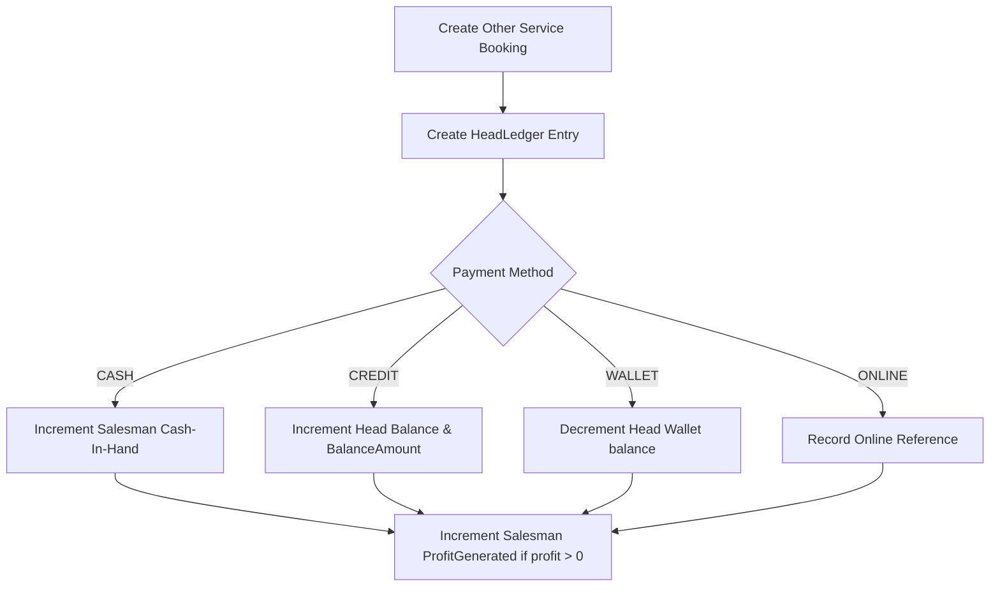

# Authoritative Other Service Booking Contract

This document defines the strict field classifications, ownership, validation, and side-effects for the **Other Service Booking** workflow. 

---

## 1. Field Classification Matrix

To ensure absolute security and prevent unauthorized manipulation of financial records, fields are classified into strict layers of authority:

### A. USER INPUT FIELDS (Passed from Browser)
These fields are supplied by the frontend during creation. They must be strictly validated before processing:

| Field Name | Type | Constraints | Description |
|---|---|---|---|
| `clientType` | `string` | Required, must be `customer` or `agent`. | The type of client booking the service. |
| `headId` | `long?` | Required if `clientType` is `customer`. Must refer to an active `Head` owned by the salesman. | The target customer account. |
| `prefix` | `string?` | Optional, max 255 chars. | Passenger/client name prefix (e.g. `Mr.`, `Ms.`). |
| `name` | `string` | Required, max 255 chars. | The passenger or primary traveler/client name. |
| `agent` | `string?` | Required if `clientType` is `agent`. | The name of the booking agent. |
| `agentId` | `long?` | Required if `clientType` is `agent`. | The database ID of the booking agent. |
| `isInhouse` | `bool` | Required. | Whether the service is processed in-house (no supplier cost/profit calculations). |
| `supplierId` | `long?` | Required if `isInhouse` is `false`. | The external supplier ID. |
| `expectedSupplierCost` | `decimal` | Required if `isInhouse` is `false`. Must be `>= 0.000`. | Expected supplier cost in BHD. |
| `amount` | `decimal` | Required. Must be `>= 0.000` with up to 3 decimal places. | The amount charged to the client (Selling Price). |
| `serviceName` | `string` | Required. Non-empty. | The type of other service (e.g. `Visa Attestation`, `Insurances`). |
| `narration` | `string?` | Optional. | Additional context or details for the ledger/booking. |
| `paymentMethod` | `string` | Required. Must be `cash`, `wallet`, `credit`, or `online`. | Settle method. |
| `bankId` | `long?` | Required if `paymentMethod` is `online`. | The receiving bank account ID. |
| `bankName` | `string?` | Optional. | The receiving bank name. |
| `status` | `string` | Required. Must be `pending` or `confirmed` (defaults to `pending`). | Initial processing status. |
| `paymentProof` | `string?` | Optional. | Path or reference to payment receipt document. |

### B. SERVER-CALCULATED FIELDS
These fields are strictly computed on the server. The server must ignore any browser-provided values for these:

| Field Name | Type | Formula / Logic |
|---|---|---|
| `payableAmount` | `decimal` | Equal to `amount`. Authoritative billing value. |
| `profit` | `decimal` | `isInhouse ? 0.000 : (payableAmount - expectedSupplierCost)`. Must fail if profit is negative (selling amount < supplier cost) unless explicit Laravel tolerance rules allow it. |
| `careOf` | `string?` | For `customer` client types, resolves to `Head.FirstName + " " + Head.LastName`. |
| `supplierName` | `string?` | Resolves from `supplierId` lookup via external Accounts API. |
| `paymentStatus` | `string` | - `wallet` payment: `success` (if wallet balance is sufficient) or `pending` (if insufficient).<br>- `cash`/`online` payments: `success` or `pending` depending on authorization.<br>- `credit` payment: `pending`. |

### C. SERVER-OWNED FIELDS (Authoritative Context)
These fields are resolved dynamically from the authenticated HTTP request context (`ICurrentUser` / `ClaimsPrincipal`). Any browser-passed inputs for these must be ignored:

| Field Name | Type | Value Source |
|---|---|---|
| `createdBy` | `long` | Resolves to the authenticated user ID (`NameIdentifier` claim). |

---

## 2. Financial Side-Effects (Atomic Mutations)

Creating a booking executes the following atomic mutations inside a database transaction:



---

## 3. Read Response Fields (DTO Output)

The response payload returned by the details/list endpoints is structured as:

```json
{
  "id": 1024,
  "createdBy": 1,
  "headId": 1,
  "clientType": "customer",
  "name": "Jane Doe",
  "serviceName": "Attestation",
  "payableAmount": 60.000,
  "expectedSupplierCost": 40.000,
  "profit": 20.000,
  "paymentMethod": "cash",
  "paymentStatus": "success",
  "processingStatus": "pending",
  "createdAt": "2026-07-11T08:00:00Z"
}
```
