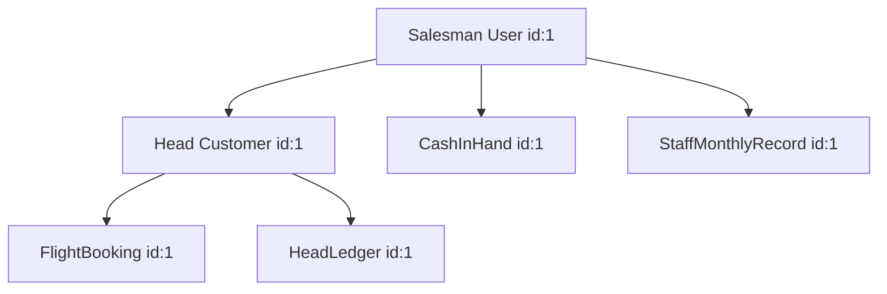

# Target Test Data Strategy

This document details the strategy for populating minimal relational smoke data in the disposable target SQL Server database for integration queries.

---

## 1. Test Data Graph & Relationships

To test the mapped query translations cleanly, we load a minimal deterministic relational graph:

### Deterministic Test Record Values
- **User (Salesman)**: Name: `Test Salesman`, Email: `salesman@texasportal.com`, Salary: `500.000 BHD`.
- **Head (Customer)**: First Name: `John`, Last Name: `Doe`, Email: `john.doe@gmail.com`, Balance: `100.000 BHD`.
- **FlightBooking**: Payable Amount: `75.000 BHD`, From: `BAH`, To: `DXB`.
- **HeadLedger**: Debit: `75.000 BHD`, Credit: `0.000 BHD`, Description: `Flight Booking Payment`.
- **CashInHand**: Amount: `25.000 BHD`.
- **StaffMonthlyRecord**: Month: `July`, Year: `2026`, Profit Generated: `150.000 BHD`.

---

## 2. Execution & Cleanup Policy

- **Isolation**: Test data is seeded inside a transaction block or recreated cleanly by running `EnsureDeletedAsync()` / `MigrateAsync()` before test execution.
- **No Production Mixing**: Seed queries are restricted strictly to testing targets and never run on production connection strings.
- **Deterministic Identifiers**: Explicit identity inserts or PK allocations are used where possible to avoid random database auto-numbering.
